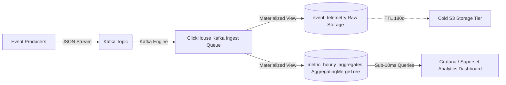

# ClickHouse Production Analytics & Real-Time Data Mart Blueprints

Production-grade schemas, materialized view aggregation pipelines, Kafka streaming connectors, and compression optimization blueprints for ClickHouse.

## Repository Contents
- `schemas/`: Optimized `ReplacingMergeTree` & `AggregatingMergeTree` tables with ZSTD and DoubleDelta codecs.
- `materialized_views/`: Real-time aggregations computing quantiles, distinct users, and throughput.
- `ingestion/`: Kafka streaming engine integration with Dead Letter Queue (DLQ) support.
- `optimizations/`: Cold-storage tiered policies and compaction tuning.
- `docker/`: ClickHouse + ClickHouse Keeper multi-node local staging setup.
- `benchmarks/`: Synthetic analytical data generator.

## Enterprise Production Bundle
Looking for Grafana production dashboards, automated `clickhouse-backup` disaster recovery recipes, and enterprise multi-tenant RBAC policies?
Download the complete Enterprise Pack directly from the Releases tab or support continued development via [Buy Me a Coffee](https://buymeacoffee.com/rahulwork247).

## License
MIT License - Copyright (c) 2026.
